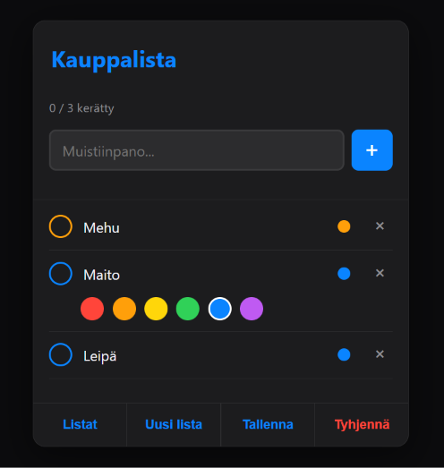

# Projektin nimi

**Tekijä(t):** Milli Haverinen

## Projektisuunnitelma

### Projektin idea

Sovellukseni on inspiraationa Iphonen muistutukset sovelluksesta. Ensimmäinen ajatus oli, että haluan listan joss aon pallura mistä saan valittua muistiinpanon esim. tehdyksi ja vielä, niin että palluran värin saa valita mieleisesksi muutamasta vaihtoehdosta. TÄmä värin valinta johtaa siihen, että merkintojä pystyy helpommin seurata värikoodien avulla.

### Suunnitellut toiminnot

Listaa vähintään kolme sovellukseesi suunniteltua toimintoa:

- Värivalinta palluroihin 
- listoja pystyy tallentaa ja selata
- Listan pystyy tyhjentämään yhdellä napilla

### Rautalankamalli / luonnos

Lisää tähän kuva käsin piirtämästäsi tai digitaalisesti tehdystä sovelluksen luonnoksesta. Luonnoksessa tulee näkyä sovelluksen pääasiallinen näkymä ja tärkeimmät elementit.

Esimerkki kuvan lisäämisestä:

## Verkkolinkit

- **Julkaistu sovellus:** [Lisää tähän GitHub Pages -osoite]https://millimalau.github.io/Web-kehitys1-projekti/
- **GitHub-repositorio:** [Lisää tähän repositorion osoite] https://github.com/Millimalau/Web-kehitys1-projekti.git
- **Projektin videoesittely:** [Lisää tähän videon osoite](https://www.loom.com/share/6387dbacc88d46b09e9dcd46030fb796)

## Tietoja sovelluksesta

Listasovellus on verkkosovellus, jolla pystyy tekemään erilaisia to do listoja helpottamaan arkea. Sovellus toimii kauppalistojen tekoon, kotitöiden tekoon, pakkauslistana tai mitä ikinä kukakin keksiä listaamaan arjessa. Parasta siinä on, että listoja pystyy olemaan samanaikaisesti monta ja niitä pystyy nimetä aiheen mukaan ja tallentamaan myöhemmälle käytölle.

## Teknologiat

Kuvaile, mitä teknologioita käytit ja mikä niiden rooli oli projektissasi.

- HTML – sivun rakenne
- CSS – ulkoasu ja asettelu
- JavaScript – toiminnallisuus, DOM-skriptaus ja lomakkeiden validointi
- localStorage – tietojen tallentaminen selaimeen, jos käytit sitä

## Sovelluksen käyttö

Kirjoita lyhyet käyttöohjeet sovellukselle.

1. Avaa julkaistu sovellus yllä olevasta linkistä.
2. Täytä lomakkeen kentät.
3. Lisää kohteita, merkitse tehdyksi, tallenna, poista ja tyhjennä.
4. Päivitä sivu ja tarkista, säilyvätkö tiedot selaimessa, jos käytit localStoragea.

## Sovelluksen käynnistäminen paikallisesti

1. Kloonaa tai lataa tämä repositorio omalle koneellesi.
2. Avaa projektikansio.
3. Avaa `index.html` selaimessa.

## Kuvakaappaukset

Lisää tähän vähintään yksi kuvakaappaus toimivasta sovelluksestasi.

Esimerkki kuvan lisäämisestä:

## Tunnetut virheet / puutteet

Kerro, jos sovelluksessa on tunnettuja virheitä, puuttuvia toimintoja tai muita rajoituksia.

Jos tunnettuja virheitä ei ole, kirjoita: **Ei tunnettuja virheitä.**

## Oma arvio ja oppimisen reflektointi

Pohdi työtäsi ja oppimisprosessiasi.

- Missä onnistuin?
- Mikä oli haastavaa?
- Mitä parantaisin, jos aikaa olisi enemmän?
- Mitä opin HTML:stä, CSS:stä, JavaScriptistä ja DOM-skriptauksesta?
- Mikä jäi epäselväksi tai mistä haluaisin oppia lisää?
- Oma arvio projektista: **xx/10 pistettä**

Oppimiskokemus jäi vähän pieneksi. Panos mitä käytin tähän ei ollut iso, Ollaan oltu lapsen kanssa molemmat tässä kipeensä viimeset pari viikkoa, eikä olla päästy kouluun tai päiväkotiin ja monista kursseista tehtävät laahannu. En pstynyt tähänkään käyttää ihan hirveästi resursseja. Turvauduin siis koodien osalta tekoälyn käyttöön. Eniten tärkein eli javascript ja dom-skriptaus jäi vähän epäselväksi. Se miten käytin tekoälyä toki oli paljon sparrailua kyselin millaset ratkaisut parhaita ja kokeilin sen avustuksella joitain toimintoja. Korjailin myös itseä mieleiseksi osia ja tekoäly olisi halunnut tehdä ohjelmasta monimutkaisemman, joten itse yksinkertaistin sovellusta. Harmittaa paljon, että en päässyt itse kunnolla kirjoittamaan koodia ja tekemään täysin itse työm. Olen kuitenkin kiinnostunut aiheesta ja tykkäsin websivu kurssista, mutta aina ei voi mennä ihan nappiin ja joskus täytyy ottaa takkiin. Olen kuitenkin tyytyväinen tohon mitä sain nyt aikaiseksi. Antaisin itselle muuten 10/10 tosta sovellksesta, koska se on juuri sellainen mitä ajattelin, mutta koska en itse käyttänyt niin isoa panosta mitä olisin voinut niin ehkä 7/10 voisi olla ok. 

## Lähteet ja kiitokset

Listaa kaikki projektissa käyttämäsi lähteet, tutoriaalit, kuvat ja koodiesimerkit.

Jos käytit ChatGPT:tä, GitHub Copilotia tai muuta tekoälytyökalua, mainitse se tässä ja kerro lyhyesti, miten se tuki työskentelyäsi.

- [Lähteen tai tutoriaalin nimi](https://example.com/)
- [Kuvalähde](https://example.com/)
- Käytetty tekoälytyökalu: Käytin claudea
  - Miten työkalua käytettiin: Minulla oli oma idea jonka sain inspiraationa Iphonen muistutukset sivulta. Käytin claudea sparraamaan miten saisin siitä inspiroituneena omanlaisen ja aikalailla koko javasript on otettu claudelta

  ## Lisenssi

Tämä projekti on lisensoitu MIT-lisenssillä.

Lisätietoa lisenssin lisäämisestä GitHub-projektiin:
https://docs.github.com/en/communities/setting-up-your-project-for-healthy-contributions/adding-a-license-to-a-repository